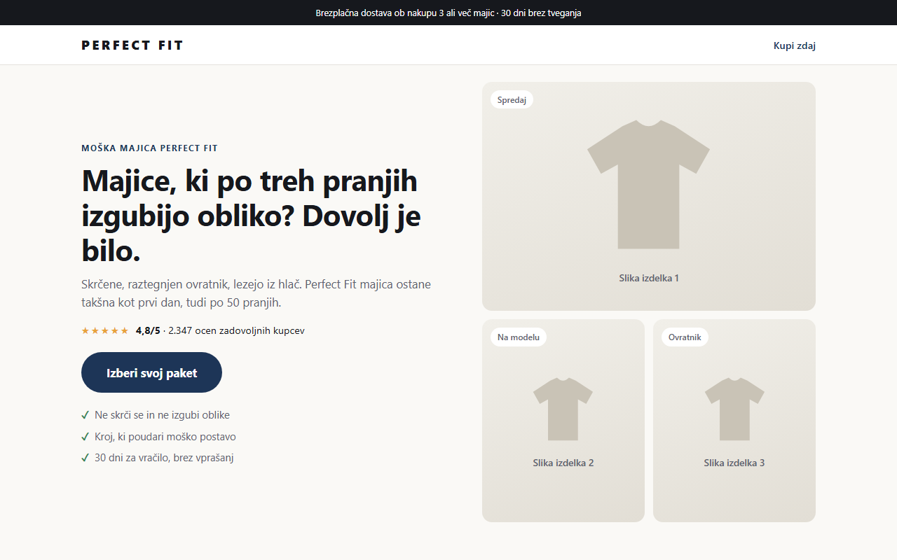
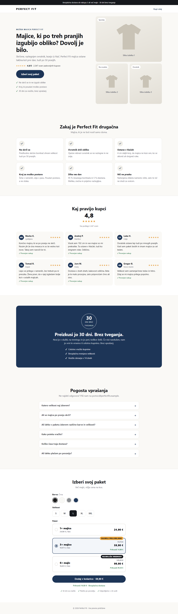
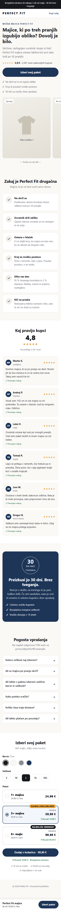

# Product Finder

A command-line tool that finds products **advertising heavily on Facebook elsewhere in Europe** (e.g. FR, ES, NL, AT) that are **not yet present in our markets**: SI, HR, HU, PL, SK, CZ, RO, GR, BG, IT, DE.

The tool is aimed at our product categories: **t-shirts, men's boxers/underwear and socks**. These are the default search keywords.

It collects active ads from the Meta Ad Library, groups them into products, scores each product 0–100 and flags any product that already reaches our markets. The results go to a ranked CSV and a short terminal summary.

> **Status:** `--demo` mode works end to end on realistic sample data. Live Meta Ad Library fetching is stubbed out (`finder/meta_api.py`) until API access is available.

## Quick start

Requires Python 3.10+. Demo mode uses only the standard library, so no install step is needed.

```bash
python main.py --demo
```

Example output:

```
Analysed 212 active ads -> 18 products
  14 not in our markets (opportunities)
  4 already advertising in our markets

 #  Score  Page               Domain                    Age  New  Ads   EU reach  Our markets
---------------------------------------------------------------------------------------------
 1   92.5  BambooBro          bamboobro.com             112    8   26  1,367,565  -
 2   88.8  BoldBoxers         boldboxers.com            102    7   24  1,251,340  DE, IT, PL
 3   87.5  Merinoo            merinoo.fr                 95    7   22  1,031,558  -
 ...
```

The full ranking is saved to `results.csv`.

## Options

| Flag | Default | Description |
|---|---|---|
| `--demo` | off | Use built-in sample data instead of the API |
| `--keywords ...` | `boxers briefs underwear socks t-shirt undershirt` | Search terms, e.g. `--keywords "bamboo boxers" "merino socks"` |
| `--countries ...` | `FR ES NL AT` | Source countries to search |
| `--out PATH` | `results.csv` | CSV output path |
| `--top N` | `10` | Rows shown in the terminal |
| `--hide-present` | off | Drop products that already reach our markets |

Examples:

```bash
python main.py --demo --keywords socks --countries FR ES
python main.py --demo --hide-present --top 5
```

## How it works

1. **Fetch.** Active ads matching the keywords and reaching the source countries are collected. In demo mode they come from `finder/demo_data.py`, which holds 18 sample apparel products (boxers, socks, t-shirts) whose dates are relative to today.
2. **Group.** Ads are grouped into products by **advertiser page + landing domain**, with `www.` and the URL path stripped. A page that sells two products on two different shops counts as two products.
3. **Score.** Each product gets a 0–100 score from these components:

| Component | Weight | How it's scored |
|---|---|---|
| Ad age (oldest active ad) | 30% | <7 days = 0, 30 days = 0.5, 60 days = 0.8, 90+ days = 1.0 (linear in between) |
| New creatives in the last 30 days | 20% | 10+ new ads = max |
| Active ad count | 15% | 30+ active ads = max |
| EU reach (all countries) | 15% | log scale: 1k = 0, 1M+ = max |
| Reviews | 10% | *placeholder, not scored yet* |
| Traffic | 10% | *placeholder, not scored yet* |

   Placeholder components are left out, and the score is rescaled over the weights that are actually used (currently 80%), so the score still runs from 0 to 100. Once reviews and traffic are implemented, they join the calculation automatically. All thresholds live in `finder/config.py`.

4. **Market flag.** If any of a product's ads has reach in one of our markets, the product is flagged and the countries are listed (the `in_our_markets` and `present_in` CSV columns). Flagged products stay in the ranking unless you pass `--hide-present`.

5. **Output.** You get a ranked CSV with raw metrics, the per-component scores and a link to the Ad Library entry for each product's newest ad, plus a terminal summary.

## Project structure

```
main.py              CLI entry point
finder/
  config.py          markets, default keywords, weights, thresholds
  models.py          Ad and Product dataclasses
  demo_data.py       sample data for --demo
  meta_api.py        Meta Ad Library client (stub)
  cache.py           SQLite cache keyed by ad ID
  grouping.py        ads -> products
  scoring.py         scoring + market flag
  output.py          CSV + terminal summary
tests/               unit tests (stdlib unittest)
landing.html         sample product landing page (Slovenian)
docs/screenshots/    landing page screenshots used below
```

## Tests

```bash
python -m unittest discover tests
```

## Landing page

`landing.html` is a sample landing page for a made-up product, the **Perfect Fit** men's t-shirt, written in Slovenian. It's a single self-contained file built mobile-first, with all CSS inline. It has a problem headline, product images (placeholders), benefits, customer reviews, a 30-day risk-free guarantee, an FAQ and 1× / 3× / 6× bundle options. To view it, open it in any browser.



<table>
  <tr>
    <th>Desktop (1280px)</th>
    <th>Mobile (390px)</th>
  </tr>
  <tr>
    <td valign="top"></td>
    <td valign="top"></td>
  </tr>
</table>

The product images, reviews, rating count and support email are placeholders.

## Live mode (coming next)

1. Get a Meta Ad Library API access token.
2. `cp .env.example .env` and set `META_ACCESS_TOKEN=...`
3. `pip install -r requirements.txt`
4. Implement `fetch_ads()` in `finder/meta_api.py`. Its docstring lists the planned endpoint, fields, paging, rate-limit handling and caching. It must return `list[Ad]`, and everything downstream already works on that.

`.env` and the SQLite cache (`*.db`) are excluded from git through `.gitignore`.

## Database: SQLite now, PostgreSQL in production

The prototype caches fetched ads in **SQLite** (`finder/cache.py`, file `ads_cache.db`). SQLite is just a local file, so anyone who clones the repo can run the tool with nothing to install. Demo mode doesn't use the database at all.

In production the plan is **PostgreSQL**, so that several runs and users can share one ad history and results can be queried over time. All database code lives in `finder/cache.py` (one `ads` table keyed by ad ID, with the ad stored as JSON). Moving to Postgres means changing the connection, which would read a `DATABASE_URL` from `.env`, and adapting two SQL statements. Nothing else in the project changes.

## Next steps

- Implement the live `ads_archive` client, with rate-limit backoff and the cache wired in.
- Move the cache from SQLite to PostgreSQL for production.
- Reviews score, e.g. Trustpilot or on-site review counts.
- Traffic score, e.g. a GoogleTrends estimate for the landing domain.
